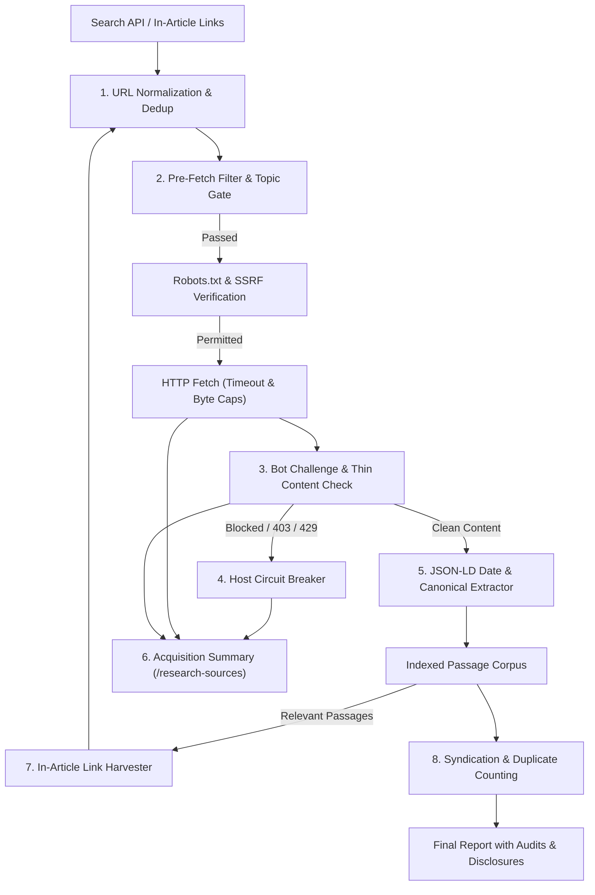

# Web Acquisition and Crawling Architecture

Pi Research builds a factual evidence corpus from public web pages to answer research questions. Unlike general-purpose web scrapers that bulk-download millions of pages, Pi Research runs under a **strict user-approved budget** (typically 8–18 page fetches per question). 

Because every page fetch consumes real budget and directly shapes the evidence seen by synthesis models, the acquisition pipeline uses eight specialized safeguards to ensure high source quality, protect budget, and maintain responsible Information Retrieval standards.

---

## The 8 Core Crawling Mechanisms

---

### 1. URL Cleaning and Deduplication
- **The problem:** Web pages often carry tracking tags (such as `?utm_source=twitter`, `?fbclid=...`, or `?gclid=...`) or different URL variants (AMP pages, trailing slashes, default ports). Comparing raw URL strings causes the crawler to treat identical pages as different, paying twice to fetch the same content.
- **How it works:** Before any candidate URL is queued, `normalizeUrl()` cleans it:
  - Strips marketing and analytics parameters (`utm_*`, `fbclid`, `gclid`, `mc_cid`).
  - Removes default HTTP/HTTPS port numbers (`:80`, `:443`).
  - Unwraps Google AMP prefix paths (`/amp/` or `.amp`).
  - Standardizes trailing slashes and lowercases hostnames.
- **Result:** Candidates are compared against both existing queue items and the `finalUrl` of previously downloaded snapshots, guaranteeing that identical content is never fetched twice.

---

### 2. Pre-Fetch Filtering and Topic Relevance Gating
- **The problem:** Search engines frequently return video players, photo galleries, social media posts, or login screens that contain no readable article text. Furthermore, ambiguous queries (such as "skew" or "logging") can return top-ranked pages that are completely off-topic (e.g., OCR image skew or lumber logging).
- **How it works:**
  - **Route filter (`shouldSkipCandidateUrl`):** Instantly rejects URLs belonging to video platforms (`youtube.com/watch`, `vimeo.com`), social networks (`x.com`, `instagram.com`, `tiktok.com`, `facebook.com`), login/account gateways, and non-article media files (`.mp4`, `.zip`, `.tar`, `.exe`).
  - **Relevance gate:** Before fetching search results during a discovery round, the crawler checks whether the candidate's title and snippet share minimum lexical relevance with the research question.
- **Result:** Off-topic or non-article pages are marked as `skipped` with a clear explanation, conserving fetch budget for genuine articles.

---

### 3. Bot-Challenge and Thin-Page Detection
- **The problem:** When websites present a Cloudflare challenge ("Just a moment...", `challenge-platform`) or an anti-bot verification screen, they often return an HTTP status of `200 OK`. A naive crawler would extract this challenge text and treat it as factual research evidence.
- **How it works:**
  - `isBotChallenge()` inspects the raw HTML for well-known challenge signatures (Cloudflare `cf-browser-verification`, PerimeterX `px-captcha`, AWS WAF markers) while exempting legitimate articles that happen to mention security challenges.
  - `isThinContent()` detects pages that yield fewer than 80 characters of extracted text (such as cookie walls or "enable JavaScript" banners).
- **Result:** Challenge pages and thin wrappers are classified as `blocked` with an explicit reason. In compliance with security and ethical standards, Pi Research never attempts to solve or bypass CAPTCHAs.

---

### 4. Per-Run Host Circuit Breaker
- **The problem:** If a website denies access (returning HTTP `403 Forbidden`, `429 Too Many Requests`, or a bot challenge), attempting to fetch other articles from the same domain later in the session will almost certainly fail as well, burning through the user's allowance.
- **How it works:**
  - When a host returns a terminal block (403, 429, or bot challenge), the domain is registered in the engine's `blockedHosts` set.
  - Future candidates matching that hostname are automatically marked `skipped` with the reason `"host blocked earlier in run"`.
- **Result:** No network calls or fetch allowances are wasted on unresponsive or hostile domains.

---

### 5. Publication Dates and Canonical Metadata
- **The problem:** Readability extracts page text and titles, but research reports need to know *when* a source was published to identify outdated claims. Additionally, messy HTML sometimes causes article extractors to fail completely.
- **How it works:**
  - `parseHtmlMetadata()` scans `<script type="application/ld+json">` blocks and OpenGraph `<meta>` tags for `datePublished`, `dateModified`, and `<link rel="canonical">`.
  - If Readability cannot extract any text from an article, Pi Research falls back to the deterministic `articleBody` provided in JSON-LD structured data.
- **Result:**
  - Source-claimed publication dates are stored in immutable snapshots, rendered in `/research-sources`, and printed in report citation footnotes.
  - The canonical URL improves cross-query deduplication.

---

### 6. Acquisition Yield and Crawl Summary Report
- **The problem:** Users and researchers need clear visibility into how reliably web data was collected without digging into raw logs.
- **How it works:**
  - At the end of the `/research-sources` view, `summarizeAcquisition()` computes an aggregated crawl report:
    - Total candidate URLs discovered.
    - Yield rate (successful snapshots ÷ attempted fetches).
    - Failure breakdown by cause (robots denied, timeout, TLS error, extraction failure, bot challenge, blocked route).
    - Host-level health summary (flagging any domains that triggered the circuit breaker).
- **Result:** Full transparency into data provenance and acquisition bottlenecks directly within the CLI.

---

### 7. In-Article Link Harvesting (Zero Search-Credit Discovery)
- **The problem:** Search API queries cost significant budget (in Pi Research's controller, a search action costs 7 cost units vs. 2 for a page fetch). However, authoritative articles already link directly to primary studies, documentation, and citations.
- **How it works:**
  - `parseArticleLinks()` extracts resolved hyperlinks and anchor text from the extracted article HTML during ingestion.
  - When the model evaluates passages as relevant to an active research branch, `harvestLinks()` enqueues the in-article links as new candidate sources (`provider: 'in-article-link'`, `rankingKind: 'citation-list'`).
  - Harvested links carry full provenance pointing to the parent snapshot and passage.
- **Result:** Discovers high-value primary sources and citation networks without spending search API credits, while still enforcing route filters and robots politeness.

---

### 8. Syndication and Wire-Agency Duplicate Detection
- **The problem:** News outlets and content aggregators frequently syndicate identical wire-service stories (e.g., from Reuters, Associated Press, or PR Newswire) across dozens of different websites. Counting these copies as separate confirmations produces a false impression of independent consensus.
- **How it works:**
  - Pi Research calculates min-shingle hashes across all passages, grouping near-identical text into `duplicateGroup` identifiers.
  - `needCorroboration()` and `statementCorroboration()` count both **distinct duplicate groups** and **distinct internet domains**.
  - If a topic or statement is supported by multiple passages that all belong to the same duplicate group, `/research-map` marks it with `⚠️ syndicated copy`.
  - The final research report appends a Responsible IR disclosure:
    > *"Responsible IR note: N statement(s) cite syndicated or duplicate coverage rather than independent reporting."*
- **Result:** Prevents duplicate wire stories from inflating factual confidence.

---

## Safety and Security Guarantees

Pi Research enforces strict infrastructure boundaries on every fetch:
1. **Robots.txt compliance:** Uses an RFC 9309 parser that respects per-host `crawl-delay` and **fails closed** (disallowing crawling if robots.txt cannot be fetched or returns a 5xx server error).
2. **SSRF and IP Pinning:** Uses `ipaddr.js` to ensure the crawler never connects to private subnets (e.g., `127.0.0.1`, `10.0.0.0/8`, `192.168.0.0/16`, `169.254.0.0/16`). IP addresses are re-verified at every redirect step.
3. **Deterministic extraction only:** No LLM-generated summaries enter the passage store. Only deterministically extracted text is indexed, cited, and stored in frozen, content-addressed blobs.
